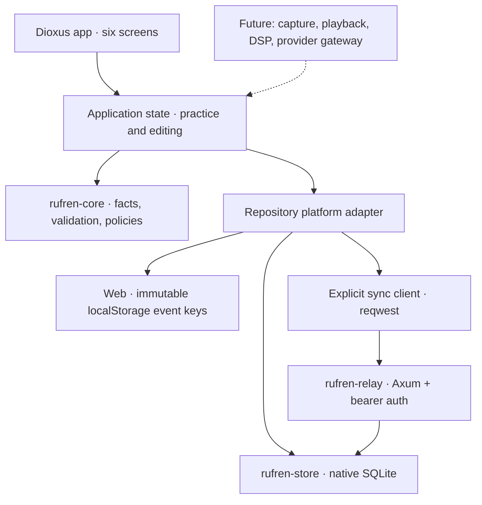
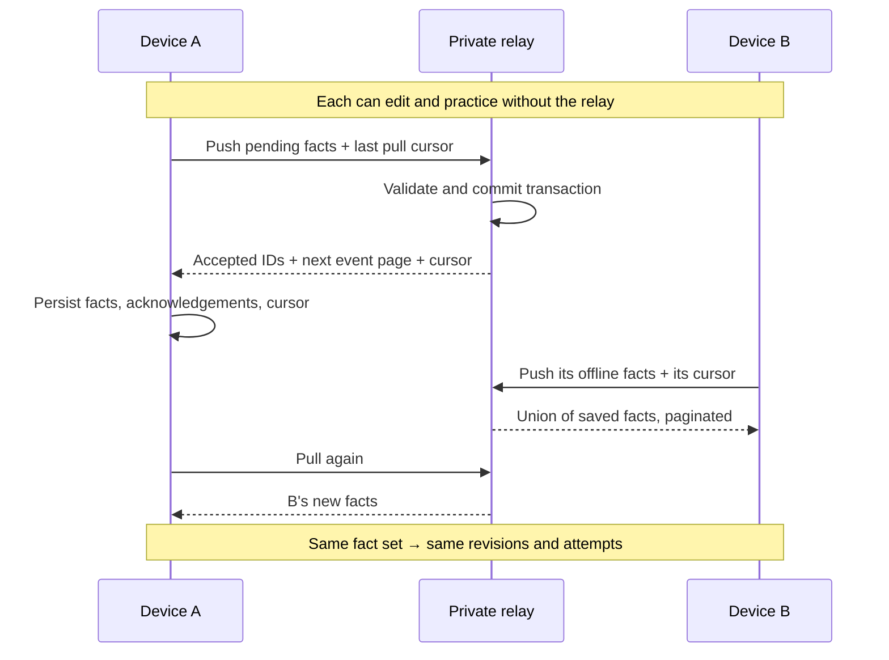
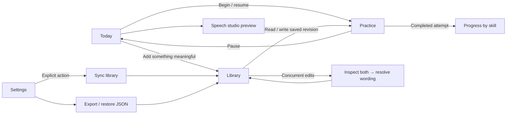
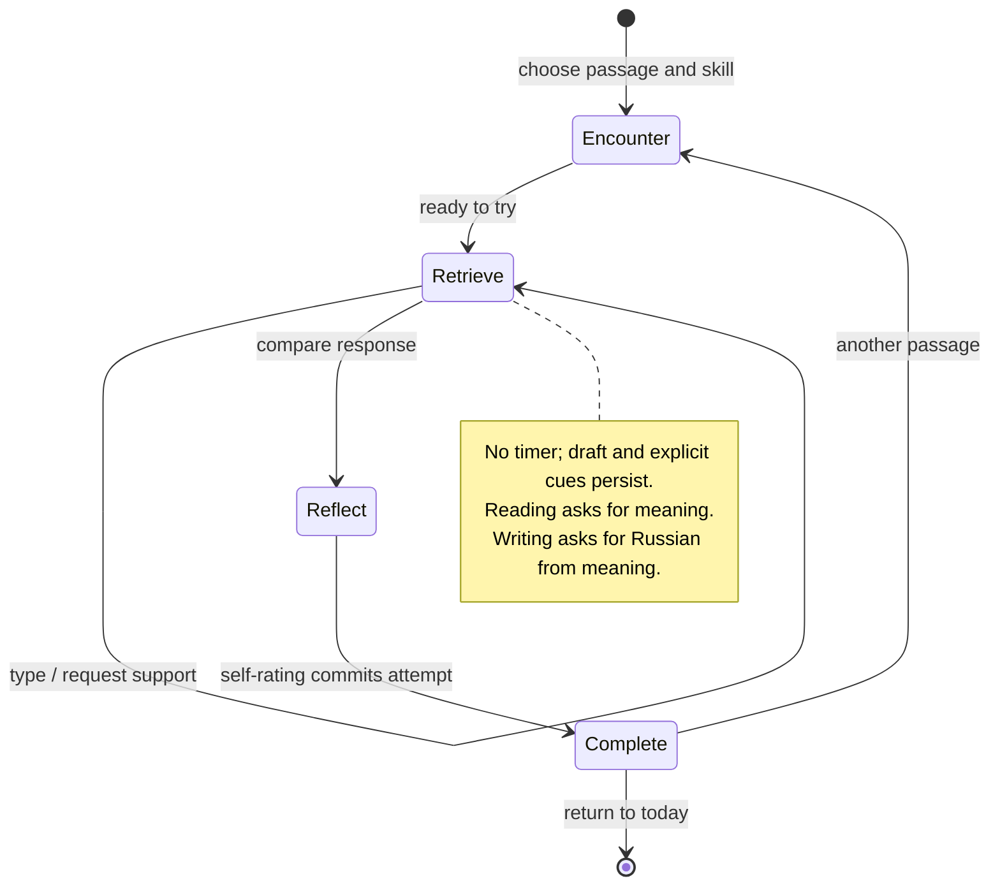

# Rufren architecture

Decision date: 2026-11-05. Ember selected Dioxus. This document describes the implemented foundation and marks future work explicitly; [DESIGN.md](DESIGN.md) remains the learning destination.

## Boundaries



| Crate | Responsibility | Excludes |
|---|---|---|
| `rufren-core` | Versioned facts, revision graph, validation, deterministic projection, teaching-policy seam, audio metadata contract | Filesystem, UI, network, cloud credentials |
| `rufren-store` | SQLite transactions, schema version, durable event log, cursor and acknowledgements | Lesson presentation or teaching decisions |
| `rufren-relay` | Single-library authenticated HTTP exchange, bounded requests, CORS allowlist | Content generation, speech scoring, personal accounts |
| `rufren-app` | Dioxus screens, interaction state, storage adapter, sync client, backup UI | Automatic correctness claims or provider calls |

The selected renderer is Dioxus's WebView route on native devices and its browser renderer on web. We are not depending on the experimental GPU renderer. UI styling is local CSS, with no remote fonts or image requests. Android/iOS audio and lifecycle behavior remain device feasibility work.

## Data and identities

The durable record is an immutable `Event`: schema version, random event UUID, writer UUID, informational timestamp, and typed fact. Device clocks never choose edit winners. Browser tabs use separate writer IDs; native installations persist one. IDs identify origin, not a trusted human identity or cryptographic signature.

Two facts exist today:

- `PassageRevised`: stable passage ID, title, Russian, meaning, source note, review flag, and parent revision IDs. Editing creates a revision; it does not mutate the previous text.
- `AttemptRecorded`: session ID, exact passage revision, skill, response, cues used, self-rating, and selection-policy ID. Self-ratings are not correctness judgments. Recorded hints remain recorded even if the learner chooses “I recalled it.”

`Library` is a replayable projection over those facts. Identical event replays are harmless; a repeated ID with different content fails. Merge validates the entire batch before changing state. Cross-item revision parents, cycles, invalid identifiers, oversized fields, and unknown versions are rejected. References may arrive before their targets during pagination; they are checked when both are present. Missing references are not synthesized into teaching content.

Concurrent edits create multiple unsuperseded revisions. The library shows each version and offers an explicit resolution containing all current heads as parents. History and attempts remain attached to their original revision. There is no silent last-write-wins rule and no deletion/compaction protocol yet.

Native SQLite has three small tables: `events(seq,id,json)`, `metadata(key,json)`, and `acknowledgements(relay,event)`. `PRAGMA user_version` gates database compatibility. Web uses namespaced keys, one per immutable event, rather than rewriting a whole library snapshot. No audio samples belong in these keys.

Local metadata includes the resumable `Session` (revision, skill, phase, draft, cues) and the sync binding (endpoint, relay UUID, cursor). A session draft stays on its device. The completed attempt becomes a replicated fact. The sync key is held only in memory; model API keys are not implemented. Native database and web data are plaintext at rest.

## Sync protocol

`POST /v1/sync`, bearer-authenticated JSON:

```text
request  = { version, relay?: UUID, after: cursor, events: Event[] }
response = { version, relay: UUID, accepted: UUID[], events: Event[], cursor, has_more }
```



Pages contain at most 128 events. Client pushes also have a roughly 1 MiB JSON budget, below the relay's 8 MiB request limit. The relay assigns its own monotonically increasing sequence; event UUID order and device timestamps are unrelated to the cursor. Accepted IDs must match the sent batch. Changed relay identity, unsupported schema, invalid pages, and collisions surface as errors.

The relay transaction makes retries safe after a response is lost. Native clients commit received facts, acknowledgements, and cursor together. Browser clients store facts first, acknowledgements second, cursor last: interruption can cause replays but cannot intentionally advance past unstored data. Browser batches can partially persist on quota failure and safely be retried. Different tabs can leave a stale cursor that causes extra replay, without replacing event keys. Browser storage is still quota-limited and not an archival guarantee.

No background sync, account discovery, provider credentials, audio upload, or hosted service is implied. Syncing uses all unacknowledged local facts, including imports, so a backup can seed a new relay. Received facts may be resent once before their acknowledgement is recorded. A relay restored to an older snapshot rejects an ahead-of-history cursor; the user disconnects and reconnects to re-establish continuity. Disconnect clears delivery acknowledgements while keeping facts, so reconnect can resend the complete history.

## UX map



All six screens remain reachable through the main navigation, with all six destinations visible in a compact grid on narrow screens. Current navigation is local application state, without URL deep links. The first encounter starts with a tiny original science-fiction passage; it is labeled as awaiting coach review. This is a functional exercise seed, not a complete zero-Russian curriculum.



The foundation offers one focused step at a time, user-controlled pace, and an explicit hint. It keeps the model answer out of the retrieval view until requested. Reflection displays the original and meaning beside the response; it does not invent automated correctness. Progress shows practice counts and self-reported recall, separately by skill. Speech controls are not shown as working until capture/playback is connected.

## Extension contracts and next layers

1. **Teaching:** `TeachingPolicy` is replaceable; the current `least-practiced-v1` is only a deterministic baseline. It has no spacing model. Add review timing, target features, delayed probes, context and judgment provenance before claiming adaptive competence estimates. Coach judgments should be new facts referencing attempts, preserving original self-reports.
2. **Audio:** `AudioAsset` describes content-addressed audio metadata. Next add capture/playback adapters with permissions and interruptions, an asset repository, and explicit attachment facts. DSP consumes normalized PCM, independent of Dioxus and providers. Timestamped annotations, acoustic measurements, confidence/quality flags, and model version belong in separate typed records. An audio hash is an identity, not an accent score.
3. **Providers:** future interfaces distinguish language tutoring, ASR, TTS, and acoustic assessment. Put provider secrets in OS secure storage or a private gateway; browsers do not ship embedded keys. Record generated content and review provenance before using it as a trusted reference. No provider is called today.
4. **Persistence:** indexed projections and incremental graph checks will replace full-history reads when measured size warrants them. Move browser storage to IndexedDB before audio/large libraries. Add service-worker caching for offline browser startup. Preserve export and do versioned migrations with retained backups; never resolve schema failure by clearing data.
5. **Continuity:** synchronize annotations and assets, add resumable hash-verified transfers, then background triggers and a deliberate multi-device draft handoff. Add a relay deployment recipe with TLS, backup/restore drills, and revocation before relying on it remotely.

New incompatible facts require a schema/protocol change. Version 1 currently rejects unknown versions rather than silently dropping fields. Durable facts and their migrations take precedence over convenience of UI refactors. Raw recordings, personal text, private keys, and learner histories stay outside source control.

## Verification scope

Eight focused integration tests pass: divergent revision convergence, explicit resolution, malformed/cyclic histories, unknown-field rejection, ID collisions, transactional rejection, SQLite reopen, paging beyond one batch, relay identity mismatch, cursor rollback on invalid downloads, disconnect metadata, unauthorized HTTP writes, and two offline stores converging through the real relay router with concurrent edits.

The Mac target passes `cargo check`; the browser build runs. Browser QA exercised Cyrillic input, reading and writing attempts, draft/hint recovery after reload, self-rated recall with a hint remaining assisted, backup replay without duplicates, and two separate browser origins syncing conflicting edits and an explicit resolution through the relay. Disconnect/reload preserves the notebook. Screenshots were inspected at desktop and 390-pixel phone width; no body overflow was observed. Local QA records and screenshots live under ignored `.local/`. This is not physical iOS/Android validation or a completed accessibility audit.

Remaining risks are explicit: localStorage quotas and cross-tab metadata races, full-log projection cost, untested native/mobile lifecycle, no encrypted sync payload, no deletion protocol, and no deployed relay. These constrain the foundation's current use, not the intended destination.
