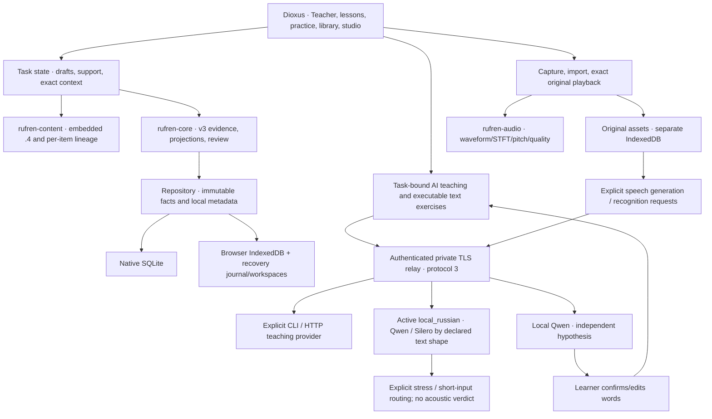

# Rufren architecture

Updated 2026-11-06. Rust/Dioxus is the selected implementation. The AI teacher carries explanations, examples, corrections, pronunciation models and practice. The friend’s conversations over meals are optional real-world use, without assigned recording, grading or approval work. [DESIGN.md](DESIGN.md) and [COMPLETENESS.md](COMPLETENESS.md) preserve the full learning destination.

The current web artifact is **`3c220ad5d98c19691d7d`** (5.55s/16 assets). It changes foreground colors and placeholders from the accepted Teacher/region build; 3,023 rendered text/control contrast checks pass across 28 scene/viewports. Functional evidence remains scoped to its recorded artifacts: real context-aware Claude lesson, replayed lesson/actual inline voice, region controls and visible corrections. Matching readable-UI iOS and signed Mac artifacts are frozen with unchanged build inputs. Desktop/device acceptance is still pending.

The accepted older full-live v3 Teacher/ASR flow remains d15099; bbeafe adds accepted bounded errors/offline 14. Two real bbeafe→592a0 worker-update runs preserve durable state using explicit synthetic teacher/transcript fixtures with zero API/external calls. The main private TLS relay remains protocol 3 with Opus/high, active local_russian and local Qwen ASR. These are capability-specific receipts, not overall completion or a validated accent assessor.

## Boundaries

| Crate | Responsibility | Boundary |
|---|---|---|
| `rufren-core` | Versioned passage/attempt/presentation/AI/human/transcript facts, reference graphs, learner observations, spacing and inspectable diagnostic comparator | No UI, network, samples or secret handling; no feature mastery inferred from a whole-response grade |
| `rufren-content` | Embedded original curriculum, per-phrase version/ancestry, task validation and scoped answer matching | Generated editorial origin is explicit; no fabricated human endorsement or native-speaker audio |
| `rufren-audio` | Bounded PCM/WAV, waveform/STFT/pitch/quality and descriptive A/B measures | Instruments do not classify Russian accent correctness |
| `rufren-store` | SQLite facts/metadata/record registry, transactional replication state | Original encoded audio bytes remain separate |
| `rufren-relay` | Authenticated protocol 3 facts, asset registry/blobs, teaching, generation, recognition and cancellation routes | Explicit provider configuration, bounds and shared-key access; no account discovery, automatic deployment or billing changes |
| `rufren-tutor` | Exact-task teaching/feedback DTOs; isolated Claude CLI and Anthropic HTTP adapters | AI provenance and model/profile/usage modes remain explicit; text/transcripts cannot support acoustic claims |
| `rufren-speech` | Bounded generated WAVs/independent original-audio transcription; explicit local_russian Qwen/Silero routing, separately configured Milena/Gemini and worker auditing | ASR is a hypothesis; confirmation is learner adoption, not proof of phonetic correctness |
| `rufren-app` | Eight destinations, executable Teacher exercises, exposure acknowledgments, exact audio/ASR/confirmation flow, drafts/workspaces, consent and sync | Browser/native/device and acoustic acceptance remain separate |

Native uses the Dioxus WebView route; web uses the browser renderer. The experimental GPU renderer is not a dependency. Native Mac capture/reopen is observed; physical iPad behavior and the rebuilt native picker/title still need their own acceptance.

## Facts, compatibility and proof semantics

New events write **version 3**, while old v1/v2 facts remain readable and byte-preserved. New actual-presentation, ASR, confirmation and `NotReported` facts require v3; legacy fact types retain their supported minimums. Deterministic authored imports intentionally remain v2 so inherited phrases reproduce the exact historical Event bytes. A UUID identifies immutable content; existing ID/different content is rejected. Writer IDs and timestamps are provenance, not authenticated people or conflict winners. SQLite schema, backup, event, asset and sync versions are separate contracts.

The fact set includes:

- `PassageRevised`, `AttemptRecorded`, `AttemptContextRecorded`: exact content, response, question/choices/reference, skill/task/features, support, selection policy and original optional self-report.
- `AiAssessmentRecorded`: exact response/context or confirmed-transcript binding plus provider/model/response/prompt provenance, correction and next step. AI feedback never impersonates a named human.
- `CoachJudgmentRecorded`/`CoachAnnotationRecorded`: optional sourced human judgments/notes and explicit supersession; names are compatibility details, not a requirement for a coach.
- `TeachingDecisionRecorded`: selected action, alternatives, assumptions and hypothesis forecasts. A recommendation alone is not completed teaching or exposure.
- `RecordingAttached`: exact take/target, original encoded SHA-256 and a decoding observation. Metadata is not evidence of local bytes or pronunciation quality.
- `StimulusPresented`: actual acknowledged opportunity to see/hear the retained text, with purpose/session/revision/decision where applicable. Import/definition or presence in a hidden DOM element is not presentation.
- `SpeechTranscribed`: the exact attempt attachment/hash/original-frame span and independent ASR hypothesis, with model/runtime/manifest/worker/derivative audit. Empty recognition remains a valid observation.
- `TranscriptConfirmed`: explicit learner confirmation/edit with competing edits/supersession preserved. Neither original audio nor the attempt response is overwritten.

`Library` validates batches atomically before projection mutation. Unknown versions/fields, cycles, unrelated supersession, invalid spans and inconsistent known references fail. Out-of-order pages may contain a link before its target; validation runs again when the target arrives. Passage and feedback conflicts retain multiple heads until explicit resolution. No missing fact is synthesized.

`SelfRating::NotReported` means no self-rating was supplied. Inline Teacher exercises use it instead of manufacturing success or failure; an unrated observation does not postpone existing spaced review or count as independent recall. Guided Teacher tasks retain reference assistance. Whole-answer judgments remain attempt-level evidence, not direct mastery of every tagged feature.

Visible-text observers acknowledge only rendered visible opportunities, with collapsed/offscreen/background/removed content withheld; 9 focused rich-child browser cases pass. Successful reference playback separately acknowledges audio presentation. These observations do not prove attention or learning. Novelty means no prior recorded exposure in the available app history, with embedded-phrase/family matching and uncertainty for legacy probes lacking an input log. A definition alone is not exposure; a probe’s own first task input is not previous restudy. Outside-app familiarity is not inferred. Coverage is scoped to instrumented paths, not every Russian string in the app: direct lesson sound notes, phrase notes/chunks, transfer prompts and alphabet/examples still need an on-visible audit. Teacher correction/caveat coverage is accepted; no complete all-screen history is claimed.

## Persistence, local workspaces and history

Native facts/metadata use SQLite in the app data directory (`RUFREN_DATA_DIR` overrides it). Browser startup hydrates IndexedDB and migrates old localStorage without changing fact IDs. A synchronous recovery journal remains until its IndexedDB transaction commits. Errors surface without reset; immutable event keys protect other tabs’ facts.

WebLock-owned per-tab workspaces isolate active/paused practice, editor indices, teacher exercise/response, prepared context and transcript drafts. 12 browser contract checks cover cloned-tab ownership, stale broadcasts, identity/plan reload, inactive-window recovery/switching, live-owner protection and legacy migration without copied sessions. Earlier actual Dioxus multi-tab/recovery/phone evidence is retained separately. Workspaces are local, not remote draft synchronization.

Practice snapshots preserve exact question/source edition/response/phase/support and selected recordings. Passage drafts autosave per identity, retain source/meaning and preserve an immutable pending save for idempotent retry. Partial event-batch recovery repairs missing context/audio links without duplicating an already durable attempt. Browser keys stay in memory; Apple native connection bootstrap can retain the private connection in device-only Keychain. Environment-free physical-device recovery is still untested. Notebook/audio stores are plaintext at rest.

## Curriculum identity and teaching policy

Embedded **`2026-11-05.4`** has 6 units, 24 lessons, 169 phrases, 172 exercises, 50 targets, 12 sources and a 33-letter reference. The extension adds eight lessons/66 phrases. Optional paired `phrase_revision`/`previous_phrase_revisions` fields pin all 103 inherited items to their `.3` lineage; 66 new items use `.4` with empty parents. Resolved item lineage drives deterministic UUID/source/parents rather than resetting every phrase when packaging changes.

Three lineage checks prove inherited actual v2 Events/serialized bytes, all four skill ReviewKeys/due histories and opposite import-order convergence; nine activated content checks pass. Existing immutable attempts keep their original references, and human-edited heads remain genuine conflicts. Stress/meaning changes must remain distinct learning content rather than being equated by ordinary spelling alone. See [the content contract](crates/rufren-content/README.md).

`SpacedReview` remains the transparent exact-revision/skill baseline: bounded fixed intervals, advancement only after the scheduled delay, assistance retained and early repetitions unable to postpone review. Due retrieval precedes answer reexposure. Its thresholds/intervals are engineering hypotheses rather than fitted retention probabilities.

The interim contrast comparator has explicit diagnostic prompt/distinct-response contracts, repeated-utterance deduplication, instruction epochs and completed same-policy/session/revision/skill timing. Human approval is not mandatory; AI explanation is an available action. Real presentation history improves exposure accounting, while unknown legacy history remains unknown. Forecasts are labeled heuristic, without assumed policy improvement or POMDP optimality. Core v3 evidence 9 + learning 16 + policy 6 + AI feedback 8 pass; learning efficacy still needs observations. [Theory](research/OPTIMAL_LEARNING.md) and [pedagogy](research/AI_TEACHER_PEDAGOGY.md) retain the broader questions.

## Bounded lesson history and exact preparation

`teacher_context.rs` builds a lesson-specific summary capped at 2048 UTF-8 bytes: up to four relevant recent observations, bounded Unicode question/response excerpts and at most two feedback opinions per observation. Relevance uses stable passage families, explicit authored exercise IDs, or qualified AI lesson-exercise origin v2—not a guessed title or the latest response. This origin format is distinct from event/sync version 3. Legacy generated identities remain readable and byte-preserved but are not retrospectively assigned a lesson origin.

The summary retains actual skill/task, self-report/cues, AI versus optional human opinion, and only uniquely learner-confirmed spoken words. Future, duplicate-session, missing-source, conflicting-context, unconfirmed-speech and budget omissions are explicit. Whole-response judgments are not feature mastery and absence of app history is not a diagnosis or beginner-ability result. Quoted excerpts are data rather than policy instructions.

Preparation saves the exact request-ID/source-fact snapshot locally before sending, bounded at 32 KiB. Response acceptance uses that prepared snapshot instead of recomputing a newer history that arrived while the model worked. Prepared context and teacher/transcript/region drafts are workspace-local. Ten context cases, 17 app units, 9 observer cases and 12 workspace cases pass in this phase; current integration-specific acceptance is recorded separately.

Teacher prose uses an inert Markdown vocabulary: escaped HTML, no image fetches, only absolute HTTP(S) links without controls/whitespace, and bounded parser depth/text. Each rendered block has its own visibility observer and plain exposed text; a long response is not fully credited because its start is visible. Correction/caveat paths also use PresentedRussian/TeacherProse; actual UI checks prove corrections/suggestions are acknowledged and the rich caveat is withheld while collapsed then acknowledged on visibility.

## Executable Teacher and spoken-word flow

The current Teacher page requests lessons with that bounded history and offers real inline reading/writing answer boxes. Typed exercises carry exact prompt, reference Russian/meaning, supported skill and source provenance. Submitting saves an immutable actual response/context with `NotReported`, requests task-bound feedback and preserves local draft/retry identity. New exercises retain qualified lesson origin v2 and exact immutable context; legacy exercises retain their original retry bytes. This is executable practice rather than a displayed suggestion, while guided completion remains distinct from independent recall. Inline example voice controls reuse a deterministic immutable v2 reference per provider/model/response/index, validate changed-source collisions, and record successful playback against that exact revision; creating the reference itself does not fabricate exposure.

The spoken flow reads the selected immutable attachment’s original bytes—never the latest take by convenience—verifies asset/hash/shape and sends only that bounded recording to the independent local recognizer. No expected answer conditions the ASR. The hypothesis and full audit persist. The learner confirms or edits the words before text teaching uses them; request/response bindings require the exact active confirmation. Teacher feedback then concerns those words and preserves the original recording. The accepted current UI output acknowledges ё/e ambiguity and makes no acoustic judgment.

Authenticated routes include Teacher status/teach, speech status/generate, recognition status/transcribe/cancel and legacy general-text tutoring. The main TLS relay uses existing Claude CLI native login with Opus/high and returned model/profile provenance. Max remains explicit for preparation; the separate Anthropic HTTP backend retains API credentials/model-specific accounting. Safe-mode isolation, bounded pipes/deadlines, no ordinary tools/MCP/session persistence and only the internal schema helper remain provider constraints. Request 120s/Teacher relay 110s/provider 100s are limits, not desired interaction durations. Exact contracts are in [PROVIDERS.md](research/PROVIDERS.md).

Earlier max calls timed out. A pre-v3 genuine Opus/high lesson succeeded in 18.9s, followed by kept example→Milena→completed listening in 21.2s total. Current v3 acceptance now covers lesson 21.0s, exact written critique 12.8s, ASR 7.1s and confirmed-word feedback 15.5s, with 24 events restored offline and zero browser errors. Actual outputs were inspected, including an unrelated written answer correctly rejected against its exact question. This verifies a usable flow, not a measured learning gain.

## Reference speech, originals and instruments

Main speech now uses `RUFREN_SPEECH_PROVIDER=local_russian`, strategy `rufren-local-russian-v1`; main TLS health/protocol 3 and enabled Teacher/ASR/speech status were checked. Routing is chosen before inference, never as a hidden failure fallback. Authored acute stress goes to Silero with an exact before-vowel `+` transformation and automatic accent/homograph/ё rewriting controls disabled. Ordinary unmarked full utterance shape (at least eight Russian tokens plus sentence ending) goes verbatim to Qwen; other ordinary short input goes to Silero with its five automatic controls explicitly enabled and recorded. These shape/model choices do not establish semantic disambiguation or correct acoustic stress.

Known short/noncontextual unmarked homographs return actionable HTTP 400 before inference or allowance consumption; literal `+` is rejected as authored text. The actual marked public castle request returned a canonical WAV in 4.059155s, retaining exact request/source, `Это з+амок.` input, hashes, CPU settings and router provenance. Its 0.975-second waveform matches the earlier controlled comparator hash; that reproducibility is not proof of the intended audible stress. Exactly one automatic `Здравствуйте!` request also passed in 3.830693s, yielding 24 kHz mono PCM16/0.975s, identical source/input hashes, all five automatic controls recorded and zero conversion clipping. This is functional/identity acceptance, not a lexical or acoustic listening verdict.

The Qwen-only BF16 path previously passed a current-v3 UI request in 3.323s plus exact saved source/synthesis transformation, WAV/hash, playback and offline replay. Its contextual pedagogical-acute removal remains separately declared/preserved; main-router authored acute input instead uses Silero. Milena and Gemini are explicitly configurable separate backends, with no silent downgrade/fallback. Gemini still lacks accepted paid live generation. [Speech providers](research/SPEECH_PROVIDERS.md) and [speech teacher](research/SPEECH_TEACHER.md) retain model/runtime/license details and provisional acoustic status.

The Web Audio/WebView adapter keeps original encoded blobs, per-take metadata and timed cues in separate IndexedDB, including in native UI. Original-byte SHA-256 and decoded-PCM identity are different: two decoders may produce different PCM from identical encoded bytes. Attachments can exist without local bytes, so playback availability is explicit.

Capture/import/playback, crop/repeat/pitch-preserving slow A/B and interruption persistence are implemented. Encoded originals are capped at 32 MiB; portable instruments validate up to 60 seconds/16 million channel samples/eight channels/8–192 kHz and 64 MiB WAV input. Waveform, Hann-STFT, periodicity-based 50–400 Hz pitch and level/clipping/quiet observations retain original timing. Cooperative analysis yields/cancels stale work. These are instruments, not phoneme/formant/stress classifiers or an accent score. Device routes/codecs/permissions and actual acoustic quality need independent acceptance.

The [two-token explicit-stress audit](research/SILERO_STRESS_AUDIT.md) motivated the now-implemented original-frame region API and two-region lab. `RegionSpan` uses half-open original sample frames; time controls round to exact original boundaries. Metrics preserve whole-original PCM identity plus the selected span, duration and quality/RMS observations without introducing a crop identity or hidden time warping. Encoded asset hashes remain a separate caller binding. Cooperative WAV parsing and 25 audio contracts/WASM pass.

The UI now offers editable A/B regions, shared-scale plots, original-time replay, persisted workspace selections and exported identities/frames. Actual browser acceptance now proves exact 24k original-frame duration/RMS/shared-scale geometry, mouse/touch/keyboard, invalid-bound recovery, same-asset A/B, export/slow replay, rapid picker races, same-workspace reload, separate-workspace isolation and corrupt-focus rejection, with zero errors/no API calls. Region replay checks the actual reference identity before recording its encounter; learner audio cannot stand in for a model. The current exposure fact conservatively associates a played crop with its full intended reference and has no acoustic-span field: it does not prove every word was heard. Original-frame identity remains in playback/selection receipts.

The exploratory candidate-vowel durations roughly 140/50 ms versus 75/145 ms, non-flipping pitch/level pattern and unstable LPC poles remain useful reference observations, not a two-token classifier or dependable automatic formants. Exact original-frame crops/plots are retained under `research/artifacts/silero-stress-v1/`; no new inference/GPU study was run for that audit.

## Sync and backup

`POST /v1/sync` now exchanges **protocol 3**, up to 128 facts/about 1 MiB JSON per page, with a relay SQLite sequence cursor independent of UUIDs/clocks. Native events/acks/cursor commit transactionally; browser persistence stores facts, then acks, then cursor so interruption replays instead of skipping. Import can seed a restored relay. Changed relay identity/ahead-of-restored-history cursor requires explicit reconnect, preserving facts. Old v2 clients cannot sync with the current v3 service. The selected frozen iPad artifact has now been rebuilt to v3; its v2 predecessor is retained only as an incompatible archive.

Original-audio transfer remains separately enabled, UUID-bound to the connected relay and committed before registry advertisement. Asset pages are bounded 64 records/256 KiB, metadata 96 KiB, originals 32 MiB and default storage 512 MiB. Hash/length and immutable metadata checks retain originals under errors; timed cues merge by union. Whole-original retries are not resumable range uploads. All private routes authenticate before extraction/storage, CORS uses exact origins and redirects are rejected. Gateway failure bodies are read only up to 2048 bytes and can reach the user only through an exact status/message public allowlist; unrecognized bodies use generic guidance. Native 2, JavaScript streaming 7 and an actual tablet ambiguity/error UI check pass, including no inference and hidden arbitrary-body text. Facts/assets use 60-second limits; Teacher uses 110 seconds below the app’s 120-second limit.

Versioned notebook JSON contains immutable facts/links, not local drafts/preferences/keys or audio bytes. The separate audio export includes originals/take metadata/cues. Relay restore needs a committed SQLite snapshot plus verified original blobs/manifest; a live private HTTPS service is established, but a complete real-host restore/device-divergence acceptance remains open. [Deployment/recovery](deploy/README.md) records that contract.

The isolated v3 recovery drill now validates online snapshots during writes, exact recording/take associations, finalized standalone SQLite files, strict manifest claims and fact-first missing-audio detection. An ahead client retains its facts/cursor on failure and explicitly reconnects to reseed; a fresh independent client downloads exact playable originals. TLS uses a fixture-CA/hostname-verified Node transport for real app requests. This is not device trust or real-host credential/configuration recovery. See [storage recovery](research/STORAGE_RECOVERY.md).

## Native delivery and remaining acceptance

Earlier native Mac microphone/playback/reopen and exact paste/SQLite/WebKit recovery passed. Current readable-UI v3/`.4` Mac and iPad builds each complete in about 3s. Immutable artifacts are `.local/ipad-delivery/frozen-v3-readable-ui/{Rufren-macos.app,Rufren.app}`; metadata, Mac ad-hoc signature and iOS device/Mach-O checks pass. `v3-readable-ui-build-source.json` records 145 unchanged inputs and web reference 3c220. Exact executable hashes and retained older artifacts are in [platform delivery](research/PLATFORM_DELIVERY.md).

Current native UI still awaits desktop unlock; the older retained QA process is not acceptance of this binary. Apple’s updated Program License Agreement still requires user acceptance before provisioning/sign/install. Active iPad receipt aliases select `frozen-artifact-v3-readable-ui.json`. No physical-device launch or environment-free Keychain reconnection is claimed.

Current acceptance includes the v3/context/region source/consumer tests, 9 rich visible observers, 12 workspaces, actual Teacher replay/inline voice and actual region UI, alongside the actual full d15099 Teacher/ASR/confirmation/offline flow, Qwen neural-reference UI and new bbeafe actionable error UI. Store/network v3 migration guards each pass: legacy v1/v2 facts reopen byte-preserved, and protocol 2 push/pull is rejected before exposing history. The single short automatic hybrid case is now accepted; final native UI regressions remain blocked by desktop unlock. Current bbeafe also passes all 14 existing offline/cache/keyboard/labels/phone/tablet sanity cases with 16 correctly versioned shell assets and zero errors. Two actual older→newer service-worker runs now pass bbeafe→592a0: failed HTTP 503 new-WASM install preserves offline old shell, old tabs pin activation, then a new offline page recovers exact durable work and clearly synthetic teacher/transcript fixtures/14 facts. The test is storage/lifecycle evidence, not a live-model fixture-quality claim. Scoped current text contrast passes; full VoiceOver/non-text/focus contrast and future current-context/region migration fixtures remain separate. [TASKS.md](TASKS.md) records exact logs/artifacts. Earlier browser/audio/offline and Mac capability evidence remains valid for those tested builds.

Remaining work is acoustic/listener evaluation, native UI after desktop unlock, physical iPad after Apple agreement, full screen-reader/contrast/device breadth, independently delayed/novel learning use and physical multi-device/real-host service restore. Plaintext storage, browser eviction, local-only drafts, shared-key revocation, full-history projections, whole-blob transfers and absent deletion/end-to-end encryption remain operational limits. There is no validated accent assessor or demonstrated native-like learner outcome, and the overall completion contract remains open.
