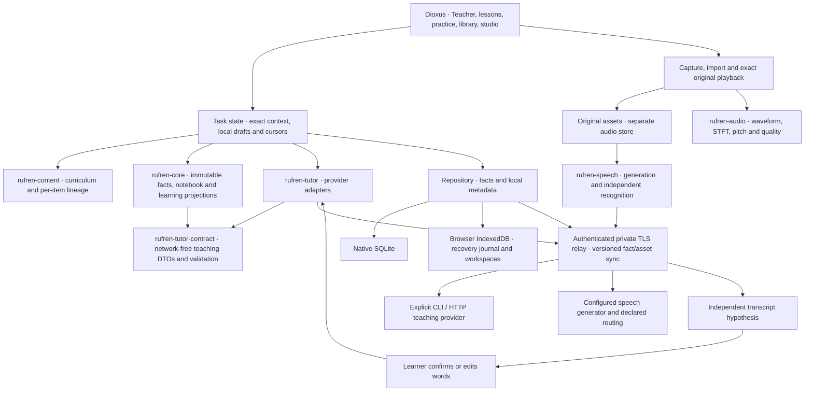

# Rufren architecture

Updated 2026-11-06. Rufren is a Rust/Dioxus personal Russian learning environment. The AI teacher provides explanations, examples, reference speech, exercises and language feedback. Conversations with the friend over meals are optional real-world use, without assigned grading, recording or approval work. [DESIGN.md](DESIGN.md) and [COMPLETENESS.md](COMPLETENESS.md) retain the full learning destination.

This document describes the implemented boundaries and data contracts. The main private relay serves protocol 5, Teacher prompt 6 and dialogue policy 2. Saved contextual questions, branched conversations and spoken messages compose with the notebook, four-skill practice and delayed returns. Final web source navigation and actual-output UI checks pass; matching Mac/iPad artifacts are selected. Protocol-4→5 migration and real HTTP/SQLite/original-audio recovery have separate scoped receipts. Physical iPad provisioning still awaits Apple's agreement, and current native UI acceptance awaits desktop unlock. [TASKS.md](TASKS.md) is definitive for artifacts, activation, checks and remaining work.

## Boundaries

| Crate | Responsibility | Boundary |
|---|---|---|
| `rufren-core` | Versioned learning facts, immutable Teacher documents and receipts, reference graphs, spacing and inspectable diagnostic comparison | No UI, network, audio samples or secrets; whole-response grades do not establish feature mastery |
| `rufren-tutor-contract` | Shared exact-task requests, responses, provenance, bounded validators and optional guided lesson flow | Portable Serde types; no HTTP, Tokio, provider execution or dependency on core |
| `rufren-tutor` | Teaching provider adapters, service configuration, budgets and execution isolation | Reexports the contract DTOs at their existing paths; one type/validator definition serves gateway, app and archive |
| `rufren-content` | Original curriculum, stable targets, per-phrase ancestry, task validation and scoped answer matching | Editorial/generated origin is explicit; no fabricated human endorsement or native-speaker audio |
| `rufren-audio` | Bounded PCM/WAV handling, waveform/STFT/pitch/quality and descriptive comparisons | Instruments do not classify Russian accent correctness |
| `rufren-store` | SQLite facts, metadata, recording registry and transactional replication state | Original encoded audio bytes remain separate; physical schema version is independent of event/protocol versions |
| `rufren-relay` | Authenticated fact and asset sync, teaching, speech generation, recognition and cancellation | Explicit configuration and bounded requests; no automatic account discovery or billing changes |
| `rufren-speech` | Bounded generated WAVs, independent original-audio transcription and worker provenance | ASR is a hypothesis; confirmed words do not establish acoustic correctness |
| `rufren-app` | Teacher notebook and guided practice, curriculum, exposure acknowledgments, exact audio/transcript flow, drafts, workspaces and sync | Renderer, deployment, device and acoustic acceptance remain separate |

Native uses the Dioxus WebView route; web uses the browser renderer. The experimental GPU renderer is not a dependency.

## Immutable facts and compatibility

New events and fact sync use **version 4**. Existing v1/v2/v3 facts remain readable without rewriting their event versions, identities or payloads. `TeacherDocumentRecorded` requires v4; presentation, transcription, confirmation and `NotReported` require v3; earlier fact types retain their supported minimums. Deterministic authored imports and generated reference definitions intentionally remain v2 so the same content reproduces historical Event bytes. Event encoding, sync protocol, document format, backup, asset transport and SQLite schema are separate contracts; the physical SQLite schema remains version 1.

An Event UUID identifies immutable content. Reusing an Event ID with different content fails. Writer IDs and timestamps are provenance, not authenticated people or merge winners. `Library::merge` validates a batch atomically, including cross-reference types, audio identities, document identity, cycles and supersession. References can arrive before their targets on another sync page; known references are checked again when targets arrive. Concurrent passage edits and competing feedback remain visible until explicitly resolved. No missing evidence is synthesized.

The principal facts are:

- `PassageRevised`, `AttemptRecorded`, `AttemptContextRecorded`: exact content, literal response, question/choices/reference, skill/task, support, source edition, policy and optional self-report.
- `AiAssessmentRecorded`: an exact saved attempt/context or confirmed transcript, correction/verdict and provider/model/response/prompt provenance. AI feedback remains distinct from optional sourced human judgments and annotations.
- `TeachingDecisionRecorded`: an inspectable recommendation, alternatives, assumptions and hypothesis predictions. Selection alone is neither completed instruction nor exposure.
- `RecordingAttached`: an exact take/target, original encoded-byte SHA-256 and one decoding observation; it does not establish local byte availability or pronunciation quality.
- `StimulusPresented`: an acknowledged opportunity to see/hear retained text, with purpose and optional session/revision/decision. Definitions, hidden content and navigation intent are not presentations.
- `SpeechTranscribed`, `TranscriptConfirmed`: independent recognition of an exact recording/hash/original-frame span, full worker audit, and explicit learner confirmation or edit. Original audio and the attempt's recording label remain unchanged.
- `TeacherDocumentRecorded`: the full accepted teaching or feedback document and an archive receipt. Saving it supplies no presentation, completion, recall or mastery evidence.

`SelfRating::NotReported` retains the absence of a self-rating. Inline guided Teacher practice uses it rather than manufacturing success or failure. An unrated generic response does not postpone existing review; a completed Teacher return may schedule another check at its existing interval without advancing it. Guided responses preserve assistance; whole-answer judgments remain attempt-level observations.

## Durable Teacher notebook

A `TeacherDocument` stores a format-versioned, typed original `TeacherResponse`: the echoed exact request, complete generated content, optional guided flow, provider/model/response/prompt provenance and usage accounting. Shared contract validation runs before archival. Optional prepared-context source fact IDs are retained only when the exact matching local request snapshot exists; current history is not substituted later.

The logical document UUID reuses the existing generated-practice source namespace derived from provider, model and provider response ID. Archiving therefore preserves text/oral draft keys, generated passage/revision identities and qualified exercise origins. Multiple devices may independently record receipt events for one document. Their envelopes and optional context audit references can differ, but the full response for a logical document must be equal; a changed response under the same source is rejected atomically. No timestamp selects a content winner.

`LiveReceived` retains a known receive time. `RecoveredLocalCache` explicitly lacks an original receive time: its Event time records archival now. Queries enumerate unique documents, retain every receipt and expose bounded navigation metadata separately from full content. Display ordering uses known receipt times and clearly identified archive times for recovered-only documents; it does not resolve conflicts or assert learning.

Migration scans both surviving latest-response cache slots across saved local workspaces before overwriting them. Valid original lessons and feedback become archive facts; duplicates converge and unparseable/conflicting originals remain in their caches with recovery guidance. Overwritten lessons cannot be reconstructed from excerpts or generated reference passages. Latest-view caches remain compatibility/local-view conveniences, not the durable history.

Accepted documents participate in ordinary fact sync and notebook export, so an earlier AI lesson is discoverable after generating another lesson or opening the library on another device. Audio bytes still use their separate transfer/export contract. Selection, lesson cursor, response drafts, transcript drafts and prepared request metadata remain workspace-local; archive sync is not cross-device draft handoff.

Feedback opens its originating generated exercise only through exact saved attempt/context identities, qualified origin, archived source, task/prompt/reference/cues/skill, and literal response or active confirmed words. A title, recent lesson or matching text cannot manufacture this link. Unsupported legacy origins remain readable without retrospective attribution.

## Guided teaching and executable practice

The Teacher status advertises optional `guided_v1` capability. The app opts in only when advertised; requests and responses without the optional flow retain their legacy serialized shape. Shared validation requires an opted-in response to supply a bounded sequence with unique response-local step IDs, valid example references and each practice item referenced exactly once. A listening step may expose its written examples only as optional support. The flow expresses teaching organization, not a proficiency claim.

The UI renders a step's goal, orientation, models, optional explanation/support and executable practice. Back, next, pause and jump update a validated local cursor. “Finished for now” is a navigation position, not evidence that an answer was correct or even submitted. The full original lesson remains available behind a disclosure. Legacy saved lessons use a local orientation followed by their original practice order; the app neither regenerates their content nor claims the provider authored that sequence.

Reading/writing exercises save the literal typed response and exact prompt/reference. Listening requires acknowledged playback of the correct immutable reference; reference text/meaning/answer reveals are retained as assistance. Speaking selects an exact durable take for the attempt, independently transcribes its original bytes, and requires learner-confirmed or edited words before language-content feedback. Recording labels never masquerade as spoken words. Response edits and changed take/support state preserve prior attempts and use new draft identities as needed; retries retain original fact bytes.

Qualified AI exercise origin v2 binds a known lesson ID, source document and practice index to derived passage/revision/attempt/context identities. It is distinct from event/protocol version 4. Legacy identities retain their retry bytes without guessed lesson origins. Generated exercises do not acquire authored curriculum features or direct feature-mastery credit.

## Returning to an exact Teacher exercise

`TeacherRevisitKey` binds the archived document and practice index, preserving the original question, reference and skill for both lesson exercises and feedback follow-ups. A proved completed guided response seeds the first return about a day later. Generated Teacher references are excluded from the generic passage queue: importing a generated definition does not create a due exercise, and a missing archive cannot be replaced with a guessed question.

Returns use a separate workspace-local draft and fresh session, response, playback count and recording selection. Pausing resumes that session; an explicit fresh try creates another. Guided drafts remain separate. Reading text and the first listening playback are required task input; replay, model answers, translation and reference material retain their assistance. Speaking requires a fresh take and explicitly confirmed words for content feedback. Completed returns are immutable, self-report is optional, and AI feedback can arrive after the learner leaves the exercise.

The existing attempt/context facts carry policy `teacher-delayed-revisit-v1`, the exact exercise identity and a typed reference footer with source guided attempt/context and actual retrieval start. This adds no event or sync version. Qualification verifies the complete archived task and context rather than trusting the footer alone. Original feedback binds to the exact saved response or confirmed words. Local active pointers and unfinished drafts are not synced, while completed attempts and archived feedback are ordinary immutable facts.

Teacher prompt 6 gives current-attempt evidence precedence over the archived exercise's teaching note. An original first-encounter recommendation cannot establish current exposure or assistance on a later return; absent cues cannot establish independent recall. Feedback next actions must make sense without assuming nested practice cards are on screen. The original source note and request bytes remain intact. This server-only prompt change leaves the client assets and event schema unchanged; scoped live feedback acceptance does not guarantee every future model response.

The pure `TeacherRevisitPolicy` projects fixed 1, 3, 7, 14, 30, 60 and 120 day steps. A due response given without help can advance one step after self-reported recall or an exact-task AI-correct judgment, with separate evidence counters. Answer help and difficulty shorten the return; replay, absent outcome, contested judgments and recent target restudy have explicit conservative handling. Eligibility uses retrieval start, while the next due time is anchored to completion. Early work cannot earn a longer gap by leaving its form open; late AI feedback is attributed to the original occurrence. Co-timed attempts do not acquire an arbitrary UUID winner.

Presentation facts arriving later can qualify the derived schedule if they show matching support during the recorded attempt. The original response, cues and self-report are never rewritten. Required own task input is exempt; own replay/model audio and foreign target presentations remain distinguishable. Bounded source IDs explain derived support. These rules do not establish attention, independent retention, unfamiliarity, acoustic quality or an optimal interval for Ember. [Teacher returns](research/TEACHER_REVISITS.md) separates the research basis from this engineering policy.

## Questions, conversation and spoken messages

Teacher has two surfaces: guided lessons and saved conversations. “Ask about this” binds a question to the exact archived explanation, step, practice or feedback; returning resolves the exact source step even on a device without the origin’s local cursor, while preserving unfinished answers. A separate scene setup starts beginner role-play. Asking for English help can pause a scene without changing its original topic or losing the branch.

`TeacherDialogueUserRecorded` contains the exact request saved before transport. `TeacherDialogueReplyRecorded` contains the echoed request, structured teaching, provenance and usage. A conversation has a stable root and immutable configuration/source snapshot; each user turn names its parent reply. Multiple replies or two devices continuing the same reply form explicit branches. UUIDs and timestamps never select a semantic winner. Missing parents, source documents or speech references remain incomplete until their facts arrive; conflicting logical identities fail atomically.

The provider receives a current message of at most 2 KiB, a bounded source snapshot and up to eight whole ancestor messages from the selected branch. The entire serialized request is capped at 24 KiB. Any omitted prefix is explicit; the remaining full history stays in the notebook. Replies separate English explanation, Russian utterance, one optional next question, one optional literal correction and scene closure. The dialogue policy is `rufren-ai-dialogue-v2`, independently versioned from lesson/feedback prompt 6. Ordinary dialogue creates no practice attempt, assessment or spaced-review success.

Workspace-local composer/outbox state reserves one immutable user fact before dispatch. A failed append is recoverable under that same identity; interruption during transport becomes an explicitly uncertain outcome. Retrying sends the same request and may generate another reply if the first was lost. Replies are archived even after navigation; automatic composer advancement requires the original selection and revision still to match. Opening, syncing or restoring never sends a model request. Unsent drafts may be explicitly discarded; sent facts remain immutable.

Spoken dialogue uses typed `DialogueAudioAttached`, `DialogueSpeechTranscribed` and `DialogueTranscriptConfirmed` facts, preserving the original audio, independent hypothesis and exact confirmation/edit separately. Recognition carries null practice-attempt/revision IDs. Adoption fills the composer; sending remains a separate action, and editing the text removes its speech binding. Sent messages retain a player for their exact original and the historical confirmation actually sent. AI speech attaches to an explicit reply chunk and text hash, without creating a generic passage or review seed. Only successful playback records an audio presentation. The text teacher receives confirmed words and source identities, never an implied acoustic assessment.

These new facts require event/sync protocol 5; physical SQLite remains schema 1. Versions 1–4 retain their original payloads. Active versus staged services and migration acceptance are recorded in [TASKS.md](TASKS.md).

## Context, exposure and learning projections

`teacher_context.rs` prepares up to four relevant recent observations within a 2048-byte provider string. Relevance uses current lesson passage families, explicit authored exercises or validated generated lesson origins. It retains actual task/skill, cues, reported or absent self-rating, bounded question/response excerpts and available AI versus human opinions. Speaking contributes words only through a unique active confirmation. It excludes unrelated personal passages and makes future/ambiguous/missing-source/budget omissions explicit. No app history does not imply no prior ability; declared starting history and preferences remain separate from inferred observations.

The exact request-ID/context/source-fact snapshot is saved locally before sending. Acceptance uses that snapshot instead of recomputing newer history while the model works. Teacher prose uses escaped, bounded Markdown without image fetching or active HTML. Individual visible blocks acknowledge their exposed plain text; collapsed, offscreen, background and removed content are withheld. Successful reference playback acknowledges audio exposure separately. Neither mechanism proves attention, sound/text equivalence or learning.

Novelty means no prior exposure in the available recorded app history, with normalized token containment and utterance-family matching. A probe's own first input is not previous restudy. Legacy activity without an input log remains uncertain; definitions and recommendations are not exposure. Instrumented coverage and its remaining limits belong in [TASKS.md](TASKS.md).

`SpacedReview` is the transparent exact-revision/skill baseline: bounded fixed intervals, advancement after the scheduled delay, assistance retained, and early repetitions unable to postpone review. Due retrieval precedes answer reexposure. Its intervals are engineering hypotheses, not fitted retention probabilities. The experimental contrast comparator uses item-specific separating predictions, repeated-utterance deduplication, instruction epochs and completed-action timing. AI explanation is available without mandatory human approval. It is a heuristic comparator, not a POMDP solver, optimal policy or demonstrated learning gain. [Learning theory](research/OPTIMAL_LEARNING.md) and [AI pedagogy](research/AI_TEACHER_PEDAGOGY.md) describe the broader questions.

`BoundedPracticeBatch` selects up to 1, 3 or 5 available returns, alternating material sources and favoring less recently practiced skills within them. Quiet sessions use reading and writing. Teacher candidates retain exact document/question identities; generic candidates require an existing completed attempt in that revision and skill. Importing lesson phrases therefore creates no new review obligations. Selection is an engineering allocation rule, with no fitted memory probability or changed interval ladder.

`daily_plan.rs` keeps the selected keys, settings and exact reserved practice identities in workspace-local metadata. Only actual completed responses bound to those identities fill the plan; an unrelated or late-imported attempt cannot do so. Start and skip intents survive interrupted writes, and restarting a chosen item resumes its saved response. A completed plan remains a stopping point until the user explicitly chooses another. New lessons, conversations and free passage practice remain available separately. These local plans are not synced learning facts or historical policy snapshots for a future experiment.

Progress uses occurrence time for the last seven days, excludes future-dated attempts from current counts, and exposes their clock issue separately. Exact Teacher observations reuse the cadence classifier with derived support from later-arriving exposure history. Self-reported recall and AI correctness remain distinct channels, and late judgments on old attempts do not become new weekly activity. Recent items link back to their exact usable source. [Personal review policy](research/PERSONAL_REVIEW_POLICY.md) records the evidence limits and prospective observation/decision contracts needed before an adaptive memory experiment.

## Local persistence, sync and recovery

Native facts and metadata use SQLite in the app data directory, overridable with `RUFREN_DATA_DIR`. Browser startup hydrates IndexedDB and migrates old localStorage while preserving identities. A synchronous recovery journal remains until the IndexedDB transaction commits. Immutable event keys and workspace ownership prevent one tab from overwriting another tab's facts or active work. WebLock-owned workspaces isolate selections, cursors, practice/editing drafts and prepared requests. Apple native bootstrap can retain the private connection in device-only Keychain. Notebook/audio data remain plaintext at rest.

`POST /v1/sync` uses protocol 5 with a relay sequence cursor independent of UUIDs and clocks, bounded to 128 facts/about 1 MiB JSON per page. Older protocol clients are rejected before exposing or changing history. Native event/ack/cursor writes commit transactionally; browser persistence writes facts before acknowledgments before cursor so interruption replays instead of skipping. Changed relay identity or a cursor ahead of restored history requires explicit reconnect while preserving facts. Protocol activation requires coordinated client and relay delivery; see [TASKS.md](TASKS.md).

Original-audio sync is separately enabled and bound to the connected relay. Verified bytes commit before registry advertisement; hashes, lengths and immutable take metadata remain checked. Asset pages are bounded; originals are capped at 32 MiB and transferred as whole blobs. Cues merge by union. Authentication precedes private route extraction/storage, CORS uses exact origins and redirects are rejected. Public failure messages use an exact allowlist; arbitrary backend text is withheld.

Notebook JSON exports immutable facts/links, including Teacher documents; local preferences, cursors, drafts, keys and audio bytes are separate. Audio export includes originals, metadata and cues. Relay recovery requires a committed SQLite snapshot plus verified original blobs/manifest; fact restore cannot imply that referenced audio is present. [Deployment/recovery](deploy/README.md) and [storage recovery](research/STORAGE_RECOVERY.md) describe these contracts.

## Speech, instruments and delivery limits

Reference generation uses an explicitly configured provider. The `local_russian` router selects Qwen or Silero before inference from declared text shape and authored stress, retaining transformations and automatic-control provenance. Ambiguous unsupported short inputs return actionable errors instead of silently changing pronunciation. Milena/Gemini remain separately configurable. Generated audio is a model reference, without a validated lexical-stress or native-quality verdict. [Speech providers](research/SPEECH_PROVIDERS.md) and [speech teaching](research/SPEECH_TEACHER.md) retain model/runtime/license and acoustic evidence.

The audio adapter keeps original encoded blobs, per-take metadata and timed cues separate from facts. Identical original-byte hashes can have different decoded PCM observations. Capture, import, exact playback, crop/repeat and pitch-preserving slow A/B use original timing. Bounded waveform, Hann-STFT, pitch and level/clipping/quiet observations are instruments, not phoneme/formant/stress classifiers or an accent score. ASR verifies exact original WAV shape and decoded-source hash without expected-answer conditioning; confirmation adopts words, not their acoustic correctness.

Exact web/native artifacts, staged versus live relay versions, signing/provisioning state and device acceptance are tracked in [TASKS.md](TASKS.md) and [platform delivery](research/PLATFORM_DELIVERY.md). A compile, mock-provider journey or prior binary's microphone test does not establish current physical-device behavior. Remaining architectural limits include local-only drafts, browser eviction, plaintext storage, shared-key revocation, full-history projections, whole-blob transfer, and absent deletion/end-to-end encryption. Independent delayed learning use, native/device breadth, real-host recovery and acoustic/listener evaluation remain distinct acceptance work; the overall completion destination remains open.
