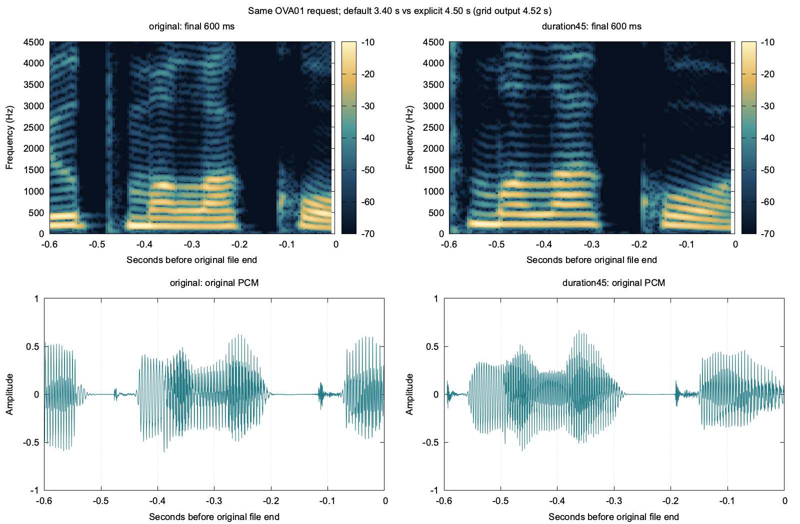

# OmniVoice duration control: longer final realization, boundary still unresolved

Exactly **one new TTS take and one independent ASR pass** were run. The explicit-duration take preserves all requested words and gives the final vowel-like region more time with lower ending energy. It still reaches the recording boundary with nonquiet periodic signal. This is a useful partial result, **not proof that truncation is fixed or that the voice is native-correct**. No further inference or production change followed; the GPU slot was released.

## Legitimate controlled input

The installed MLX-Audio 0.6.4 `OmniVoice.generate` API explicitly accepts `duration_s`. With no duration, it estimates output-token count from text using `RuleDurationEstimator`, anchored to `"Nice to meet you."` and 25 reference tokens, then multiplies by 1.15. Cyrillic and Latin characters receive the same nominal weight. This is a generic duration heuristic, not Russian phone alignment.

With `duration_s=4.5`, the supported path instead sets `target_len=ceil(duration_s*25)` before the diffusion sequence is constructed. That means **113 audio tokens**, producing **108,480 frames / 4.52 seconds** on the codec's 40 ms grid. The waveform was generated at that length; it was neither stretched nor extended with silence afterward. No model code was modified.

The exact source remains:

`Он дома, она у окна, оно открыто, а они пьют молоко.`

Language `ru`, instruction `female`, seed 42, 32 diffusion steps, guidance and all other settings equal the frozen first take. Model file hashes and the exact tokenizer/model/runtime source hashes were checked against its provenance. Only the requested duration changed. A changed diffusion sequence length can alter the whole take despite a fixed seed; this is not a claim that corresponding samples or all earlier phones are held identical.

## Actual comparison

| Observation | Original OVA01 | Explicit 4.5 s control |
| --- | ---: | ---: |
| Actual audio length | 3.400 s | 4.520 s |
| Final 20 ms RMS | −13.59 dBFS | −22.40 dBFS |
| Final 20 ms peak | 0.5352 | 0.1865 |
| Final 50 ms RMS | −12.62 dBFS | −19.88 dBFS |
| Last PCM sample | −0.00095 | 0.02063 |
| Visible final vowel-like periodic interval to file boundary | ~75 ms | ~145 ms |
| Full-scale PCM samples | 0 | 0 |
| Independent lexical hypothesis | Exact complete source | Exact complete source |

The final 20 ms energy decreases by **8.81 dB**, and the later take's amplitude visibly decays toward the boundary. The source-guided periodic intervals are original frames [79800, 81600) and [105000, 108480), with approximately ±10 ms onset sensitivity. Their right endpoints are the file ends, **not verified vowel offsets**; these are visible intervals, not complete phoneme-duration measurements. Neither take supplies a clear trailing quiet interval. The nonzero final sample does not independently prove an audible click or truncation, and quiet padding would not prove a missing vowel had been recovered.

The new independent transcript was exactly `Он дома, она у окна, оно открыто, а они пьют молоко.` No extra or omitted words were observed. The recognizer received only audio/hash/bindings and Russian language selection, without the source sentence or hints. It can recover a word from partial acoustic evidence, so this result does not settle the final-vowel question. No human listening verdict was obtained.

Model load took **7.119 s**; completed-wave generation took **2.723 s**; ASR took **10.755 s**. TTS process peak RSS was **1.659 GB** and Metal peak **2.640 GB**; these overlapping memory metrics are not additive. Timing differences from the original are not a reliable speed comparison across one cold run each. As before, output was a whole completed wave rather than streamed speech.

## Decision and exact artifacts

Retain the longer take as a separate candidate. The duration control supports the hypothesis that the default length crowds the ending, but it has not established a clean completed boundary. Do not promote a universal duration multiplier from one sentence, and do not continue extending duration until a flattering result appears. The next useful evidence is listening to both full takes and their endings with the intended phrase available, or a separately scoped voiced-ending test; additional blind generation is not justified by this control alone. Existing validated teaching examples remain available.

- [Original 3.4 s take](artifacts/omnivoice-audition-v1/OVA01.wav): `043724bb0ec7ab206fa5a4769ad2e23d6cdb2f5a8e13ea3fe1d226c378618f3a`.
- [New 4.52 s take](artifacts/omnivoice-duration-control-v1/OVA01-duration45.wav): `3bed1d92a6a1abcb43c578fe40fe0dc616b4cf62e7936868f53b15cbe98b4b46`.
- Same-basename JSON records the exact source, requested duration, model/runtime/source hashes, seed/settings, memory and timing. `OVA01-duration45-review.json` retains full independent ASR evidence. [Measurements](artifacts/omnivoice-duration-control-v1/measurements.json) preserve the original-frame observations; [evaluation](artifacts/omnivoice-duration-control-v1/evaluation.json) binds public artifact hashes and final status.
- Raw request/response, float32 original, authorization receipt and stderr are under `.local/omnivoice-audition/duration-control-v1/`. New scripts are `scripts/research/omnivoice_duration_control.py` and `audit_omnivoice_duration.py`; the acquisition script refuses a repeated run directory. No existing first-take bytes, live speech worker files, service settings or model weights changed.
