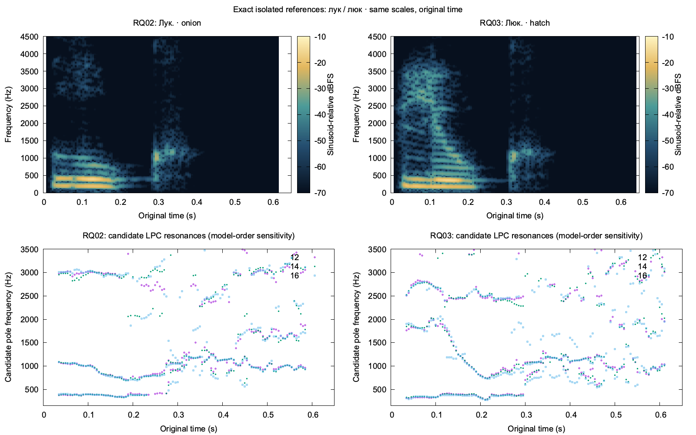

# First reference-quality batch: useful sound pair and complete mathematical sentence

Executed on 2026-11-06 against main `37d86c4`, within the granted **three TTS and three independent ASR calls**. All three passed source/routing/audio contracts and recovered the exact requested words. Three older WAV hashes were reverified. No retry, download, service change, additional model comparison or remaining-suite inference occurred.

The new isolated **лук / люк** recordings support a guided listening contrast: independent recognition distinguishes their words, and shared-scale signal inspection finds a consistent difference in the initial lateral-to-vowel region. These are usable exact examples for labelled comparison and subsequent identification of those examples. Native phonetic correctness and transfer to other tokens remain separate questions; no human listening judgment was obtained.

## Actual results

| Case and exact source | Selected provider | Audio | TTS / independent ASR wall time | Literal recognition |
| --- | --- | --- | --- | --- |
| RQ02 `Лук.` | Silero automatic, Xenia | 0.625 s, 15,000 frames | 4.126 / 5.462 s | `Лук.` |
| RQ03 `Люк.` | Silero automatic, Xenia | 0.650 s, 15,600 frames | 3.757 / 4.659 s | `Люк.` |
| RQ10 `Для каждого натурального числа существует следующее число, которое на единицу больше.` | Qwen contextual, designed voice | 6.320 s, 151,680 frames | 2.758 / 4.921 s | Exact complete source sentence |

All outputs are 24 kHz mono PCM16, with zero full-scale samples. RQ02/RQ03 peaks are 0.2955/0.3342; RQ10 peak is 0.5620. These observations screen the emitted files, not the models' unclipped internal signals. RQ10's complete independent transcript includes both occurrences of `число/числа` in their respective forms and the full ending `которое на единицу больше`; no token omission, substitution, addition or repetition was observed. Prosodic naturalness was not independently judged.

Silero returned `v5_6_ru@04cc9b1d08ce38bcaa9d02c488d80d3e6806d17f7eaa7c95982f36a3cbf50b2e;repo=e382298387332f2bf461fe6eadfde99104611b0c`, `rufren-silero-automatic-v1`, all five automatic frontend flags enabled. Qwen returned `mlx-community/Qwen3-TTS-12Hz-1.7B-VoiceDesign-bf16@7d3824abff87e49756bb0f83fb5411de75d160c4`, `rufren-qwen-russian-v2`, seed 42. Each synthesis input was verbatim. The existing main `local_russian` relay performed routing; the acquisition script did not call a substitute engine.

Independent ASR used the existing pinned Qwen3-ASR BF16 worker with explicit Russian and **no expected text, hotwords or target prompt**. Exact source/hash bindings, model revision, runtime/source hashes and resource observations remain in each `*-review.json`. Observed ASR process peaks were 4.326–4.332 GB RSS and 4.934–5.069 GB Metal. Word timestamps, confidence and acoustic assessment remain null. Comparing the returned transcript to the source happened only after recognition.

## What the transition shows

The initial resonance trajectories differ substantially before converging into the following vowel. In an analyst-selected **40–90 ms** window, the candidate second LPC pole has median **1,049–1,060 Hz** for RQ02 and **1,832–1,843 Hz** for RQ03 across model orders 12, 14 and 16. In the later **180–220 ms** window the corresponding medians are approximately **709–742 Hz** and **787–800 Hz**. This supports drawing attention to the start and its movement into the vowel, rather than comparing only the middle of the vowel. The spectral plot also shows the difference directly; it is not inferred solely from differing WAV hashes.

These windows are descriptive selections from this plot, not phone alignments. [Measurements](artifacts/reference-quality-slot1/pair-measurements.json) retain every order and a ±10 ms shift check for the early window. The bands are candidate LPC resonances, not established articulatory measurements or universal Russian formant targets. Pole order may become unstable elsewhere, especially around the final closure/release and silence. No duration of a precisely segmented lateral, classifier threshold or error probability is claimed.

The analysis uses 20 ms Hann windows, 5 ms hop, 1,024-point FFT and common sinusoid-relative dBFS scales without gain normalization. LPC uses downsampled 12 kHz audio, 30 ms Hamming windows, pre-emphasis 0.97 and orders 12/14/16. This is the bounded offline method from the [earlier stress audit](SILERO_STRESS_AUDIT.md). [Kochetov's primary Russian lateral study](https://cla-acl.ca/pdfs/actes-2005/Kochetov.pdf) motivates looking at lateral resonances and adjacent transitions; its three speakers and different phonetic contexts do not calibrate these synthetic-word measurements. See the [accepted plan](REFERENCE_QUALITY_PLAN.md) for the primary evidence and separate lexical, signal and listening criteria.

## Exact assets and consumer

| Case | Full-word/sentence WAV | SHA-256 |
| --- | --- | --- |
| RQ02 | [RQ02.wav](artifacts/reference-quality-slot1/RQ02.wav) | `bf19ea6c569402b083cd07050b8fa901530fc9a387154b18d83278088b496fd1` |
| RQ03 | [RQ03.wav](artifacts/reference-quality-slot1/RQ03.wav) | `2cdd4b1197b6c638080b5e8a2a32438b0a7bcff4073999abbaac649d8d066669` |
| RQ10 | [RQ10.wav](artifacts/reference-quality-slot1/RQ10.wav) | `52471afe3adb55242515d04d658e9c3742d9dd631a2e43beb94770cb8737c9a6` |

Each same-basename JSON carries exact source text, request binding, synthesis-input hash, selected provider and provenance. The originals and raw TTS/ASR requests/responses are retained under `.local/reference-quality/slot1/RQ02`, `RQ03`, and `RQ10`; raw TTS responses include their original base64. The exclusive attempt directory prevents accidentally repeating acquisition. [Evaluation](artifacts/reference-quality-slot1/evaluation.json) records final per-case statuses, reused hashes, and public artifact hashes. Earlier `*-review.json` files preserve the acquisition-time state before acoustic inspection; the evaluation is the final interpretation.

Optional [RQ02 transition](artifacts/reference-quality-slot1/RQ02-transition.wav) and [RQ03 transition](artifacts/reference-quality-slot1/RQ03-transition.wav) retain exactly original frames **[360, 5760)**, or **15–240 ms**. Their 225 ms PCM payloads were checked byte-for-byte against the sources. They keep the onset and vowel transition while excluding the final closure/release; play the full word by default, then use the crop to direct attention. Crops have their own hashes and original-frame bindings in the measurements.

Bind these references to **`Лук.` and `Люк.`**, never to the complete carriers `Это лук.` / `Это люк.`. The sound-learning consumer can teach both labelled models, hide the label for balanced identification of the exact examples, then record the learner's intended meaning before a fresh take and self A/B comparison. Independent ASR can suggest a recovered word for confirmation; it cannot grade the learner's lateral or infer native-like speech. Later new-token or new-voice trials test transfer rather than assuming it. No friend-labeling homework is required.

RQ01 greeting and RQ04/RQ05 stress originals passed the exact-byte checks recorded in the evaluation; they were not regenerated or recognized again. RQ06–RQ09 and the reused greeting's ASR remain unexecuted. No follow-up inference is needed to expose this exact pair for guided learning.

Reproduction: `scripts/speech/reference_quality_slot1.py` documents the bounded acquisition protocol and refuses a previously attempted case; do not invoke it to replay these results. `scripts/speech/audit_reference_pair.py` reproduces the offline plot, descriptive measurements and byte-exact crops from the pinned WAV hashes without inference.
