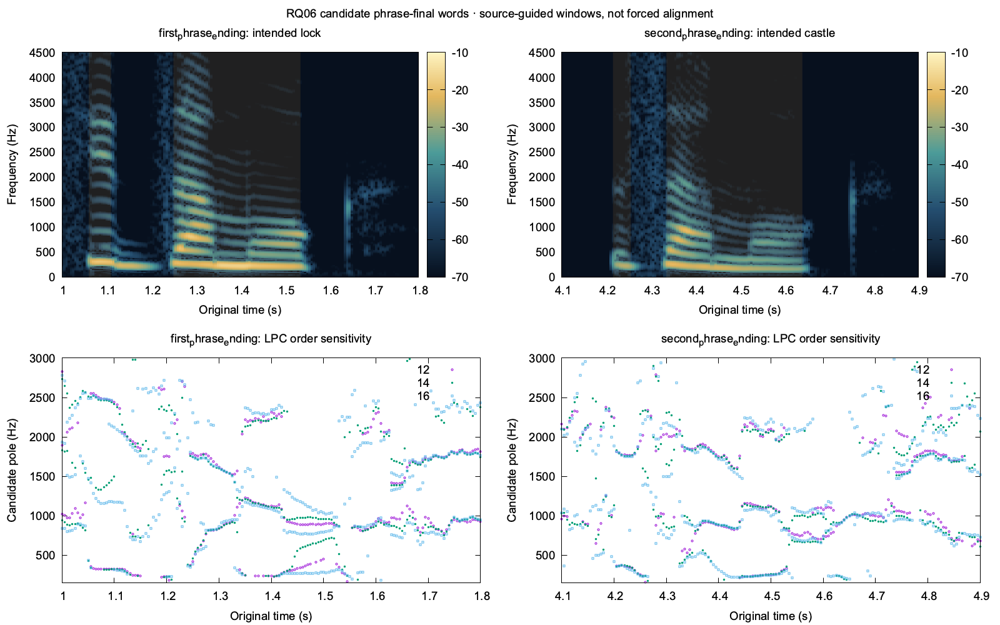

# Second reference-quality batch: explicit number wording works; contextual stress needs review

The remaining authorized batch completed **four new TTS calls and five independent ASR calls**, with no retries or downloads. RQ01 reused the original greeting; RQ06–RQ09 generated new references through the existing main router. All source, routing, synthesis-input and audio contracts passed. Slot1's frozen artifacts remained byte-identical. Model calls are complete and the GPU slot was released.

Two findings change reference selection:

- **Use authored, inflected number words for the tested number phrase.** Numeric RQ07 yielded the independent hypothesis `двадцать один свободная минута`; same-provider spelled-out RQ08 and explicit-stress Silero RQ09 both yielded the intended `двадцать одна свободная минута`. Preserve RQ07 as a suspect original, and use the distinct, source-bound RQ08 recording for this wording.
- **Do not use RQ06 as an approved lock/castle stress contrast.** All words were recognized, but both candidate phrase-ending words have short first-vowel regions and long second-vowel regions with similar spectral development. The intended stress switch is not demonstrated. The existing authored Silero stress pair remains the supported guided comparison.

These are target-specific decisions, not a global provider ranking. No human listening verdict was obtained. Numerical model output and exploratory acoustic evidence are recorded separately below.

## Actual calls and literal recognition

| Case | Exact source | Route | Duration | TTS / ASR wall time | Literal independent transcript |
| --- | --- | --- | --- | --- | --- |
| RQ01 | `Здравствуйте!` | Reused Silero automatic | 0.975 s | No TTS / 4.719 s | `Здравствуйте.` |
| RQ06 | `На двери висит замок, а на холме стоит старый замок.` | Qwen contextual | 4.960 s | 2.197 / 5.064 s | Exact source sentence |
| RQ07 | `У меня сегодня 2 вопроса, 5 идей и 21 свободная минута.` | Qwen contextual | 5.760 s | 2.517 / 4.954 s | `У меня сегодня два вопроса, пять идей и двадцать один свободная минута.` |
| RQ08 | `У меня сегодня два вопроса, пять идей и двадцать одна свободная минута.` | Qwen contextual | 5.520 s | 2.491 / 4.901 s | Exact source sentence |
| RQ09 | `У меня́ сего́дня два вопро́са, пять иде́й и два́дцать одна́ свобо́дная мину́та.` | Silero explicit stress | 3.875 s | 3.864 / 4.905 s | `У меня сегодня два вопроса, пять идей и двадцать одна свободная минута.` |

All are 24 kHz mono PCM16 with zero full-scale samples. Emitted peaks are respectively 0.7636, 0.4331, 0.6685, 0.5149 and 0.5617. ASR process peak RSS was 4.326–4.336 GB and Metal peak was 4.934–5.050 GB. Timings include each acquisition subprocess or gateway round trip, not a cross-provider quality score.

The pinned Qwen TTS model, designed voice, prompt version and seed match [slot1](REFERENCE_QUALITY_SLOT1.md). RQ06–RQ08 source text reached Qwen verbatim. RQ09 used the pinned Silero Xenia model and all five automatic frontend flags **off**, with recorded input:

`У мен+я сег+одня два вопр+оса, пять ид+ей и дв+адцать одн+а своб+одная мин+ута.`

Each ASR call received only original audio/hash, an asset/request binding and explicit Russian. No expected text, answer, hotwords or stress markup entered recognition. Complete ASR responses retain the pinned model/runtime/source hashes, timing/resource measurements and null word timestamps, confidence and acoustic assessment. Text comparisons occurred afterward. RQ01's punctuation change is preserved literally; the lexical screen does not treat punctuation as a spoken-word mismatch.

## Number interpretation and concrete repair

RQ07's value remains **21**. The observed difference is the masculine form **один** versus intended feminine **одна** in the phrase with `свободная минута`; it is not a harmless representation of `21` as words. The recognizer explicitly returned words, so numeric-glyph ambiguity does not hide the reported difference here. All other requested words and numbers were recovered.

RQ08 changes only the Qwen source representation from numeric glyphs to the intended inflected words, while retaining the model, voice, prompt and seed. Its recovered wording is correct for the authored target. This is a narrow, useful control supporting explicit spoken-number authoring for this phrase. A single recognizer can still mishear an audio token, so RQ07 is a lexical **flag**, not a confirmed human phonetic judgment or evidence that every Qwen number fails. RQ09 supplies another usable wording through a different provider/voice/frontend; it is corroboration, not a single-variable comparison.

The minimal product action is to author the intended spoken number form when preparing a reference, before synthesis. Keep display/source choices and exact synthesis text explicit in provenance. Do not run a blanket replacement of `21` with `двадцать одна`: noun gender, case and syntactic context determine the required words. Do not silently relabel RQ07's existing WAV as corrected. RQ08 is already a separately identified, successfully screened candidate; no extra generation was needed to obtain it. Provider-gateway work received these exact assets and the evidence boundary.

## Contextual homographs: targeted inspection

The source and spectral sequence suggest the candidate `замок` regions at the ends of the two clauses. These are analyst-selected, padded regions—not ASR timestamps or forced word alignment. The full [context plot](artifacts/reference-quality-slot2/context-inspection.png) preserves the surrounding utterance. Low-frequency nasal intervals between candidate vowels were excluded from the exploratory vowel regions.

| Candidate phrase ending | Intended meaning | Candidate V1 | Candidate V2 | V1 / V2 RMS medians | V1 / V2 F0 candidates |
| --- | --- | --- | --- | --- | --- |
| First | Lock | 1.060–1.110 s: **50 ms** | 1.250–1.535 s: **285 ms** | −21.4 / −20.2 dBFS | 310 / 233 Hz |
| Second | Castle | 4.215–4.255 s: **40 ms** | 4.335–4.640 s: **305 ms** | −30.3 / −27.3 dBFS | 239 / 179 Hz |

Independent ±10 ms boundary perturbations give duration ranges of 30–70 / 265–305 ms and 20–60 / 285–325 ms. These are sensitivity ranges, not confidence intervals. Both candidates retain the same broad short-V1/long-V2 pattern, rather than the reversal observed in the separately authored Silero pair. Similar late-vowel spectral development adds a reason to review the intended contrast. LPC candidate poles are visibly sensitive to order and segment; they are not certified F1/F2 labels. F0 falls in both words and must not be converted into a stress label by selecting its highest value.

The supported decision is **suspect for the intended contextual stress contrast**, while the exact phonetic stress judgment remains unresolved. Phrase-final lengthening can affect unstressed vowel duration, so duration alone cannot prove that both words were pronounced as “lock.” A primary Russian read-speech study separates effects of prominence from boundary lengthening and shows that duration and qualitative reduction need not change together. [Kocharov, Kachkovskaia and Skrelin (2019)](https://www.isca-archive.org/interspeech_2019/kocharov19_interspeech.html). Native-speaker acoustic data also show context-dependent vowel reduction, rather than a universal two-token formant threshold. [Padgett and Tabain (2005)](https://pubmed.ncbi.nlm.nih.gov/16116302/).

For targeted replay, [first phrase ending](artifacts/reference-quality-slot2/RQ06-first_phrase_ending.wav) retains original frames **[24000, 43200)**, or 1.0–1.8 s; [second phrase ending](artifacts/reference-quality-slot2/RQ06-second_phrase_ending.wav) retains **[98400, 117600)**, or 4.1–4.9 s. Both PCM payloads were checked byte-for-byte against the original. Full-utterance replay should remain available. [Measurements](artifacts/reference-quality-slot2/context-measurements.json) bind every crop and candidate region to original frames and hashes.

A discriminating repair is to author the intended homograph stress explicitly, which selects the existing Silero explicit path, and retain the source distinction. For today's guided lesson, use the already-audited `Это за́мок.` / `Это замо́к.` originals; no new comparator is required. If later evaluating this exact contextual sentence with authored stress, acquire it as a new named candidate under a separately granted slot and compare those same phrase endings. Keep RQ06's original intact; do not score a lock/castle identification trial against it on the strength of ASR spelling.

## Artifacts, statuses and verification

| Case | Original WAV | SHA-256 |
| --- | --- | --- |
| RQ01, reused | [RQ01.wav](artifacts/reference-quality-slot2/RQ01.wav) | `1f431043b464123eb9a023fe2cd52ecaccdca6f15f8a42d82b4328202ed2b138` |
| RQ06 | [RQ06.wav](artifacts/reference-quality-slot2/RQ06.wav) | `b2eba78877afec1cb6a038617bbc4f037b34f89afb1a0ac05a5b43d14893c476` |
| RQ07 | [RQ07.wav](artifacts/reference-quality-slot2/RQ07.wav) | `f194a2de0fae42ce3b0487ba4e0c9586ab9675184301862422c3a49503ad6d09` |
| RQ08 | [RQ08.wav](artifacts/reference-quality-slot2/RQ08.wav) | `f387b980b4b98a91b81f299fbb07cab01a81ca4874f2197a1bc10599eea8ceaa` |
| RQ09 | [RQ09.wav](artifacts/reference-quality-slot2/RQ09.wav) | `da717d15d9c70e49253bbcdffd9f40db25775f18354a4ef2253e25ec2f71dbae` |

Same-basename JSON records exact source, request binding, synthesis input/hash, provider/model/voice and flags. Each `*-review.json` preserves the literal independent transcript and acquisition-time comparison. Final per-case contract, lexical, target-contrast and teaching-use statuses are in [evaluation.json](artifacts/reference-quality-slot2/evaluation.json), alongside hashes of all public artifacts. RQ01/08/09 are usable for the stated lexical-reference scope. RQ06 is lexically usable but excluded from the intended scored stress contrast. RQ07 remains suspect for agreement, with RQ08 as the independently recorded repair candidate. Human listening and native phonetic certification remain unobserved in every case.

Raw immutable requests/responses, original WAV copies, attempt receipts and stderr are retained under `.local/reference-quality/slot2/<case>/`. RQ01 has a reuse receipt instead of a new TTS call. `scripts/speech/reference_quality_slot2.py` records the bounded protocol and refuses repeated attempts. `scripts/speech/audit_reference_context.py` reproduces the CPU-only plots, measurements and exact replay crops without model inference. No slot1 file, application source, configuration or relay service was changed in this batch.
