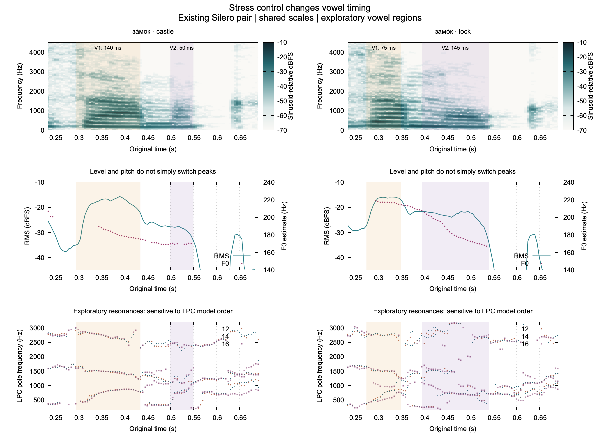

# Explicit-stress acoustic comparison

2026-11-05. **The existing Silero pair contains a useful timing and spectral contrast for guided A/B replay.** The longer candidate vowel region changes from the first syllable in `за́мок` to the second in `замо́к`. This is evidence that the explicit stress control changes the relevant signal, not a native-pronunciation certification or a learner classifier.

The two original sentences are `Это за́мок.` (castle) and `Это замо́к.` (lock), generated using the same pinned `v5_6_ru` model, Xenia voice and 24 kHz PCM16 format. Synthesis inputs differ in `з+амок` versus `зам+ок`; automatic stress/homograph rewriting was disabled. Exact source hashes, provenance, measurements and original-frame replay boundaries are in [measurements.json](artifacts/silero-stress-v1/measurements.json). No additional generation or recognition was run for this audit.

## What the signal shows

Vowel-like regions were selected by inspecting the wideband spectrogram and resonance transitions; the intervening low-frequency nasal region was excluded. These are exploratory boundaries, not expert-labeled phonemes or forced-alignment output. The ranges below deliberately move each boundary by 10 ms to inspect sensitivity; they are **not confidence intervals** or measured annotation errors.

| Candidate nucleus | Castle: first syllable stressed | Lock: second syllable stressed |
| --- | ---: | ---: |
| First-vowel region | about 140 ms; sensitivity 120–160 ms | about 75 ms; sensitivity 55–95 ms |
| Second-vowel region | about 50 ms; sensitivity 30–70 ms | about 145 ms; sensitivity 125–165 ms |
| Interior median RMS, V1 / V2 | −17.0 / −28.3 dBFS | −16.2 / −22.6 dBFS |
| Interior median F0, V1 / V2 | 182 / 170 Hz | 217 / 179 Hz |

The direction of the duration contrast survives the stated boundary choices. The first vowel remains louder and higher in pitch in **both** tokens: a “stress is the highest pitch/loudest vowel” rule would give misleading teaching advice for this pair. Phrase duration itself barely changes (0.975 versus 0.9625 seconds), so whole-recording duration would miss the useful contrast.

There is also a visible spectral difference in the second-vowel region. Its interior 300–1000 Hz power relative to 1000–2000 Hz power is about 3.8 dB in the castle token and 16.1 dB in the lock token. This describes a stronger concentration of energy in the lower band for the latter; it is not a vowel-identity or correctness threshold. The ratio is independent of uniform gain, while still depending on the chosen vowel interval, voice and recording spectrum.

**Do not expose these LPC candidates as dependable F1/F2 measurements yet.** Autocorrelation LPC orders 12, 14 and 16 give similar low-resonance estimates in the castle's first-vowel interior (roughly 825–840 Hz). In the lock token, however, changing order creates/splits low poles: the second candidate can move between approximately 1 kHz and 2.6–2.8 kHz in the second vowel. The plotted spectra remain informative, but automatic pole ordering is not reliable formant tracking. This concrete failure argues for a stability display and an unavailable-formant state, not a polished but misleading vowel-position dot.

## What the literature supports

Padgett and Tabain's Russian experiment measured duration and vowel-space changes in nine speakers. Their formant workflow included trained segmentation and correction of mistracked LPC formants; measurement placement depended on vowel/context duration. Their results motivate looking jointly at timing and spectral quality, while their procedure is substantially stronger than this automatic two-token audit. [Padgett and Tabain (2005)](https://pubmed.ncbi.nlm.nih.gov/16116302/), [paper](https://www.coli.uni-saarland.de/~andreeva/Courses/WS2023/Slavic/PadgettTabian.pdf).

Kocharov and colleagues show that Russian prominence and phrase-final lengthening affect reduction differently: increased duration does not necessarily imply the same change in vowel quality. Both target words here are phrase-final, and this pair does not separate every prosodic factor. There is no justified universal stress-duration ratio to transfer from these two examples to Ember's recordings. [Kocharov et al. (2019)](https://www.isca-archive.org/interspeech_2019/kocharov19_interspeech.pdf).

## Instrument recommendation

Add a **compare two vowel regions** view to the existing audio studio, initially for teacher references and learner-selected regions:

1. Play the complete one-second sentences first, with stressed spelling and meaning. Ask “Which vowel lasts longer?” Then allow repeated A/B word playback. The exact [castle](artifacts/silero-stress-v1/castle-word-replay.wav) and [lock](artifacts/silero-stress-v1/lock-word-replay.wav) crops preserve original samples and include consonant context; do not teach isolated vowel snippets as the entire word.
2. Display both spectrograms on the same time/frequency/level scales, with editable candidate intervals. Report region duration and the actual acoustic difference, keeping original timing rather than warping both words to look equal.
3. Keep F0 and level as optional supporting tracks. The initial cue should be the longer vowel plus the changing vowel sound, not an instruction to raise pitch or turn up volume.
4. Show tentative formant tracks only with a stability indicator across analysis settings. When poles split/merge, retain the spectrogram and say that a stable formant estimate is unavailable. No global pronunciation number follows from these measurements.
5. Invite one imitation and another meaningful phrase. A learner can benefit from this contrast immediately; neither friend labeling nor a completed phonetic calibration corpus is a prerequisite. Diagnosis of a learner's stress remains separate from demonstrating these references.

The current evidence supports using the pair as a **machine-produced, exploratory stress contrast**, with normal replay and explanation. It does not establish every segment's native quality, perception accuracy across listeners, general behavior of the model, or a quantitative error detector. The useful next implementation is the region comparison/replay instrument, not fitting a stress threshold to two synthetic tokens.

## Reproduction and checks

Run `.local/qwen3-asr/venv/bin/python scripts/speech/audit_silero_stress.py`. The [script](../scripts/speech/audit_silero_stress.py) checks the pinned WAV hashes, performs CPU-only NumPy/SciPy analysis, and renders the [PNG](artifacts/silero-stress-v1/stress-comparison.png) and [SVG](artifacts/silero-stress-v1/stress-comparison.svg) with the installed gnuplot. No new dependency or model was downloaded for the analysis. The additional primary paper was saved with a hash in the existing research archive.

Spectrogram: 20 ms Hann / 5 ms hop / 1024 FFT at 24 kHz, shared −70 to −10 sinusoid-relative dBFS scale; zero padding increases plotted sampling, not actual spectral resolution. Pitch: YIN-style 30 ms comparison window plus lag support, 80–400 Hz candidates, 5 ms hop. LPC: 12 kHz analysis audio, 30 ms Hamming window, preemphasis 0.97, orders 12/14/16. All parameter values and source/script hashes are preserved in the JSON. Pitch periodicity is not a probability of correctness.

The figure was visually inspected. Both replay crops were reopened and checked byte-for-byte against their declared original-frame spans (5,640–16,560; 10,920 frames each). This audit touches no app/core/provider code, runs no Cargo, and uses no GPU.
